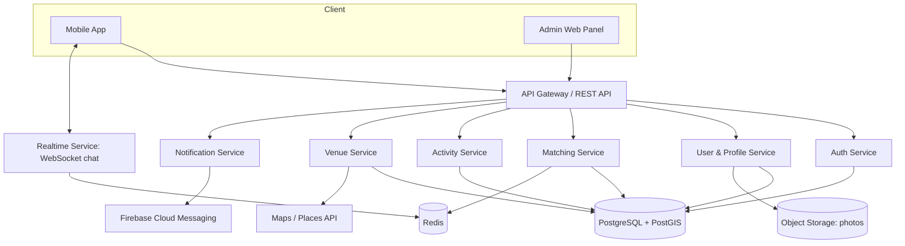
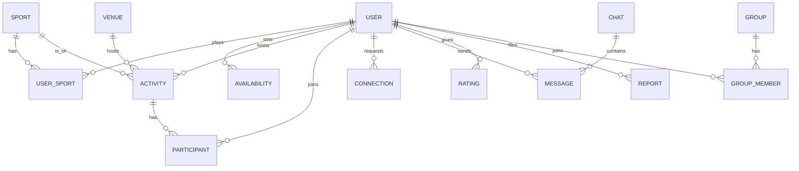

# Sportify: Design & Requirements Document

*Version 0.1 (draft for review). A social-impact app that helps people find sports partners, groups and venues that match their time, location and skill.*

---

## 1. Introduction

### 1.1 Problem Statement
People who move to a new city, or whose friends are busy at the times they are free, struggle to keep playing sport or exercising. They have no partners, no group, and no idea which nearby venues are suitable. Existing tools (WhatsApp groups, Facebook posts, word of mouth) are unstructured, do not show *who is free when*, and are hard to trust.

### 1.2 Vision
Sportify connects people through physical activity. Users say **what** they want to play, **when** they are free and **where** they are, and the app finds compatible people, groups and venues nearby.

### 1.3 Social Impact
- **Physical health:** lowers barriers to regular exercise (SDG 3, Good Health and Well-being).
- **Social connection:** reduces loneliness for newcomers, students and relocated professionals.
- **Inclusion:** women-only and beginner-friendly groups make sport accessible to people who might otherwise hesitate.
- **Community:** supports local sports venues and builds neighbourhood communities (SDG 11).

### 1.4 Goals
1. Let a user find a partner or group for a sport within minutes.
2. Match on **time availability**, **distance** and **skill level**, not just interest.
3. Make meet-ups safe and trustworthy.
4. Help groups organise recurring games without chaos.

### 1.5 Scope
**In scope (MVP):** profiles, availability, matching, activities/games, venue directory, chat, notifications, ratings, reporting, admin panel.

**MVP has two equal tracks:**
- **Partner Finder (one-to-one):** find a badminton partner, gym buddy or running companion whose free time matches yours.
- **Game Finder (group):** find, join or host group games such as futsal, cricket or basketball at a nearby venue.

The tracks are connected: a matched partner can be invited to a game, and a game with open spots can suggest suitable people from your matches (see FR-M7, FR-G8).
**Out of scope (MVP):** payments and venue booking, live game scoring, wearable integration, video features.

### 1.6 Target Users
| Persona | Need |
|---|---|
| **Newcomer** (student or professional relocated to a new city) | Find partners and a place to play |
| **Busy regular** | Find people free at the same odd hours |
| **Casual/beginner** | A friendly, low-pressure group |
| **Organiser** (runs the weekly futsal game) | Fill missing slots, manage attendance |
| **Venue owner** (Phase 2) | Get visibility and bookings |
| **Admin** | Moderate users, content and reports |

---

## 2. Functional Requirements

Priority: **M** = Must (MVP), **S** = Should (Phase 2), **C** = Could (future).

### 2.1 Authentication & Account (FR-A)
| ID | Requirement | P |
|---|---|---|
| FR-A1 | Register/login with email + password or phone OTP | M |
| FR-A2 | Social login (Google) | S |
| FR-A3 | Email/phone verification | M |
| FR-A4 | Password reset | M |
| FR-A5 | Delete account and personal data | M |

### 2.2 Profile (FR-P)
| ID | Requirement | P |
|---|---|---|
| FR-P1 | Name, photo, short bio, age range, gender (optional) | M |
| FR-P2 | Choose multiple sports, each with **skill level** (beginner / intermediate / advanced) | M |
| FR-P3 | Set home location (city/area) and search radius | M |
| FR-P4 | Privacy controls: hide exact location, who can message me | M |
| FR-P5 | Public profile showing rating, games played, badges | S |

### 2.3 Availability (FR-V) — *the core differentiator*
| ID | Requirement | P |
|---|---|---|
| FR-V1 | Set weekly recurring free time slots (e.g. Mon 6–8 PM) | M |
| FR-V2 | Add one-off availability ("free tonight 9 PM") | M |
| FR-V3 | "Play Now" mode: broadcast availability for the next few hours | S |
| FR-V4 | Sync from phone calendar to auto-block busy times | C |

### 2.4 Discovery & Matching (FR-M)
| ID | Requirement | P |
|---|---|---|
| FR-M1 | Find **partners** filtered by sport, skill, distance, time overlap | M |
| FR-M2 | Show a ranked list with a match score and overlapping time slots | M |
| FR-M3 | Find **open games/groups** nearby | M |
| FR-M4 | Send, accept and decline a partner/connection request | M |
| FR-M5 | Map view of nearby games and venues | S |
| FR-M6 | Smart suggestions ("3 people near you play badminton on Saturdays") | S |
| FR-M7 | Unified **Find** screen with a **Partners / Games** toggle sharing the same filters (sport, distance, time) | M |
| FR-M8 | Choose a play format when searching: 1-to-1 (e.g. badminton, gym) or group (e.g. futsal) | M |

### 2.5 Activities / Games (FR-G)
| ID | Requirement | P |
|---|---|---|
| FR-G1 | Create an activity: sport, date/time, venue, players needed, skill level, description | M |
| FR-G2 | Join / leave an activity; auto-close when full; waitlist | M |
| FR-G3 | Recurring activities (e.g. every Friday futsal) | S |
| FR-G4 | Host can approve requests or use open join | M |
| FR-G5 | Cancel/reschedule with automatic notification to all players | M |
| FR-G6 | Attendance check-in and no-show tracking | S |
| FR-G7 | Cost-sharing note (venue fee split shown, no in-app payment) | S |
| FR-G8 | "Invite matches": host can invite matched partners to fill open spots; a matched pair can turn their overlap slot into a 1-to-1 activity | M |

### 2.6 Groups / Communities (FR-C)
| ID | Requirement | P |
|---|---|---|
| FR-C1 | Create and join sport-based groups (public / private / invite-only) | S |
| FR-C2 | Group feed and announcements | S |
| FR-C3 | Group admin roles (owner, moderator, member) | S |
| FR-C4 | Women-only / beginner-only group flags | S |

### 2.7 Venues (FR-VN)
| ID | Requirement | P |
|---|---|---|
| FR-VN1 | Venue directory: name, location, sports offered, hours, price range, photos | M |
| FR-VN2 | Users can suggest/add a venue (admin approves) | M |
| FR-VN3 | Venue reviews and ratings | S |
| FR-VN4 | Venue owner accounts and booking integration | C |

### 2.8 Communication (FR-CM)
| ID | Requirement | P |
|---|---|---|
| FR-CM1 | One-to-one chat between connected users | M |
| FR-CM2 | Group chat per activity/group | M |
| FR-CM3 | Push notifications: requests, joins, reminders, cancellations, new nearby games | M |
| FR-CM4 | Email/SMS fallback for critical notices | C |

### 2.9 Trust & Safety (FR-T)
| ID | Requirement | P |
|---|---|---|
| FR-T1 | Report and block users, activities, messages | M |
| FR-T2 | Post-game peer ratings (punctuality, sportsmanship, skill accuracy) | S |
| FR-T3 | Verified badge (phone/ID verified) | S |
| FR-T4 | Safety tips before first meet-up; suggest public venues | M |
| FR-T5 | Share activity details with a trusted contact | C |

### 2.10 Admin Panel (FR-AD)
| ID | Requirement | P |
|---|---|---|
| FR-AD1 | Manage users (suspend/ban), review reports | M |
| FR-AD2 | Approve venues, manage sport list | M |
| FR-AD3 | Analytics dashboard (users, activities, retention) | S |

---

## 3. Non-Functional Requirements

| Category | Requirement |
|---|---|
| **Performance** | Search results in under 2 s; chat delivery under 1 s; app start under 3 s |
| **Scalability** | Design for 10k users initially; stateless backend so it scales horizontally |
| **Availability** | Target 99% uptime |
| **Security** | HTTPS everywhere, hashed passwords (bcrypt/argon2), JWT with refresh tokens, input validation, rate limiting |
| **Privacy** | Collect minimum data; exact location never shown to others (show area/approximate distance); consent and data deletion |
| **Usability** | Core flow (find a partner) in at most 3 taps after profile setup; accessible colours and text sizes |
| **Compatibility** | Android first; iOS via cross-platform framework |
| **Reliability** | Daily database backups; graceful handling of offline/poor network |
| **Maintainability** | Modular code, API documentation, automated tests, CI |
| **Localisation** | English first; structure code for Urdu/other languages later |

---

## 4. System Architecture

### 4.1 High-Level Architecture

For a sessional project, the backend can start as a **modular monolith** (one deployable app with clean internal modules named above). It is far simpler than microservices and still shows good architecture. The modules can be split later.

### 4.2 Suggested Tech Stack

| Layer | Recommended | Alternative |
|---|---|---|
| Mobile | **Flutter** (Android + iOS) | React Native |
| Backend | **Node.js (NestJS/Express)** or Django | Firebase (fastest for a student timeline) |
| Database | **PostgreSQL + PostGIS** (geo queries) | Firestore + GeoHash |
| Cache/Realtime | Redis + Socket.IO | Firebase Realtime |
| Push | Firebase Cloud Messaging | OneSignal |
| Maps | Google Maps / OpenStreetMap (free) | Mapbox |
| Storage | AWS S3 / Firebase Storage | Cloudinary |
| Hosting | AWS (EC2/ECS + RDS) or Render/Railway | Firebase Hosting |
| CI/CD | GitHub Actions | GitLab CI |

**Trade-off note:** Firebase gets you to a working demo fastest. Node + PostgreSQL shows stronger backend and database design, and PostGIS makes "nearby" queries clean. Pick based on what your teacher grades.

### 4.3 Architectural Style
- **Client-server, layered:** Presentation, Application/Business logic, Data.
- **REST** for most operations, **WebSocket** for chat and live updates.
- **Event-driven notifications:** activity events (joined, cancelled) trigger the notification service.

---

## 5. Data Model

### Key Entities
| Entity | Main fields |
|---|---|
| **User** | id, name, email/phone, password_hash, photo, bio, gender, age_range, home_location (point), radius_km, status, created_at |
| **Sport** | id, name, icon, team_size_default |
| **UserSport** | user_id, sport_id, skill_level, preferred_format |
| **Availability** | id, user_id, day_of_week, start_time, end_time, is_recurring, specific_date |
| **Venue** | id, name, address, location (point), sports[], price_range, hours, photos, status (pending/approved) |
| **Activity** | id, host_id, sport_id, venue_id, start_at, end_at, players_needed, skill_level, visibility, status, description |
| **Participant** | activity_id, user_id, status (requested/joined/waitlist/declined), checked_in |
| **Connection** | id, from_user, to_user, status |
| **Chat / Message** | chat_id, type (direct/activity/group), sender_id, body, sent_at |
| **Rating** | id, activity_id, rater_id, ratee_id, punctuality, sportsmanship, skill_accuracy |
| **Group / GroupMember** | id, name, sport_id, privacy, role |
| **Report** | id, reporter_id, target_type, target_id, reason, status |
| **Notification** | id, user_id, type, payload, read_at |

---

## 6. Matching Logic

**Step 1: Hard filters** (must pass):
- Shares at least one sport
- Within the smaller of both users' radius (PostGIS `ST_DWithin`)
- At least one overlapping availability window of minimum length (e.g. 60 min)
- Not blocked, and privacy settings allow contact

**Step 2: Score** (0–100), weighted sum:

`score = 0.35 × time_overlap + 0.25 × proximity + 0.20 × skill_compatibility + 0.10 × reputation + 0.10 × activity_recency`

- **time_overlap:** overlapping minutes per week ÷ the smaller user's total availability
- **proximity:** 1 − (distance ÷ radius)
- **skill_compatibility:** 1 for the same level, 0.5 for one level apart, 0 otherwise
- **reputation:** average peer rating, normalised
- **activity_recency:** recently active users rank higher

**Step 3: Rank and return** the top N with the overlapping slots shown ("You're both free Tue 7–9 PM").

Weights are a starting point, so document them as tunable. In your report, explain why *time overlap* has the highest weight: it is the main problem the app solves.

**Time-overlap algorithm:** store availability as (day, start, end) intervals, sort, then intersect with a two-pointer sweep per day. Complexity is O(n + m) per pair.

---

## 7. API Overview (REST)

| Area | Endpoints |
|---|---|
| Auth | `POST /auth/register`, `/auth/login`, `/auth/refresh`, `/auth/reset-password` |
| Profile | `GET/PUT /users/me`, `GET /users/{id}`, `PUT /users/me/sports`, `PUT /users/me/availability` |
| Matching | `GET /matches?sport=&radius=&day=`, `POST /connections`, `PATCH /connections/{id}` |
| Activities | `POST /activities`, `GET /activities?near=&sport=`, `POST /activities/{id}/join`, `DELETE /activities/{id}/join`, `PATCH /activities/{id}` |
| Venues | `GET /venues?near=&sport=`, `POST /venues` (suggest), `GET /venues/{id}` |
| Groups | `POST /groups`, `GET /groups`, `POST /groups/{id}/join` |
| Chat | `GET /chats`, `GET /chats/{id}/messages`, WebSocket `/ws` |
| Safety | `POST /reports`, `POST /blocks` |
| Admin | `GET /admin/reports`, `PATCH /admin/venues/{id}`, `PATCH /admin/users/{id}` |

---

## 8. User Flows & Screens

### 8.1 Key Flows
1. **Onboarding:** sign up → verify → pick sports and skill → set location → set availability → land on Home.
2. **Find a partner:** Home → choose sport → see ranked matches with overlap → send request → chat.
3. **Join a game:** Discover → filter (sport/time/distance) → open activity → join → reminder notification.
4. **Host a game:** Create activity → pick venue → set players and level → publish → approve requests → check-in.
5. **Post-game:** rating prompt → optional "play again" invite.
6. **Bridge flow:** match with a partner → tap "Plan a game" on the shared free slot → pick a venue → publish as a 1-to-1 or open group game → matched people are invited to fill spots.

### 8.2 Screen List
Splash, Login/Register, Onboarding (sports, location, availability), Home/Discover, Match list, Profile (own/other), Availability editor, Activity list, Activity details, Create activity, Map view, Venue list/details, Chats list, Chat screen, Groups, Notifications, Settings and privacy, Report/Block, and Admin dashboard (web).

---

## 9. Security, Privacy & Safety

- **Authentication:** short-lived JWT access tokens plus refresh tokens; OTP rate-limited.
- **Authorisation:** role-based (user, host, group moderator, admin); check ownership on every write.
- **Location privacy:** store precise location server-side only; expose approximate distance ("~2 km"); never reveal home address.
- **Data protection:** encrypt in transit (TLS) and at rest; minimum data collection; clear consent screen; account and data deletion.
- **Abuse prevention:** report/block, profanity filter, rate limits on requests and messages, admin review queue.
- **Meet-up safety:** first-meet safety tips, prefer public venues, optional verified badge, women-only groups, share-my-activity feature.
- **Minors:** set a minimum age (e.g. 16+ or 18+) and state it in the terms.

---

## 10. Testing Strategy

| Level | What | Tools |
|---|---|---|
| Unit | Matching score, time-overlap function, business rules | Jest / PyTest |
| Integration | API + database, auth flows | Supertest / Postman |
| UI | Key flows on device/emulator | Flutter integration tests |
| Performance | Nearby-search query under load | k6 / JMeter |
| Security | Auth bypass, input validation, rate limiting | OWASP ZAP checklist |
| Usability | 5–10 real users complete the "find a partner" task | Observation + survey |

---

## 11. Roadmap

| Phase | Deliverables |
|---|---|
| **Phase 0: Planning** | This document, UML diagrams, wireframes, backlog |
| **Phase 1: MVP** | Auth, profile, sports, availability, **Partner Finder + Game Finder (equal priority)**, the bridge between them, venue directory, chat, push, reports, basic admin |
| **Phase 2** | Groups, recurring games, map view, ratings, "Play Now", venue reviews, verified badge |
| **Phase 3 (future)** | Venue booking and payments, venue-owner portal, calendar sync, leaderboards/challenges, wearable integration |

**Suggested sprints for the sessional:** (1) auth + profile, (2) availability + matching, (3) activities + venues, (4) chat + notifications, (5) safety + admin, (6) testing, polish and demo.

---

## 12. Risks & Mitigations

| Risk | Mitigation |
|---|---|
| **Cold start:** empty app = no matches | Launch in one campus/area first; seed venues; let users create open games; recruit sports clubs |
| Safety incidents with strangers | Reporting, verification, public-venue guidance, safety tips, women-only groups |
| No-shows ruin games | Attendance tracking, reputation score, reminders |
| Inaccurate venue data | Admin approval, user suggestions, periodic review |
| Scope creep | Strict MVP list; everything else is Phase 2+ |
| GPS/location privacy concerns | Approximate distances, granular consent |
| Name resembles "Spotify" | Fine for coursework; check trademark before any real launch |

---

## 13. Assumptions & Open Questions

**Assumptions used in this draft**
1. Mobile-first (Android), with a small web admin panel.
2. A single city/region for launch, with no payments in the MVP.
3. Venues are listed for discovery only (no booking).
4. Team-sized project with roughly one semester to build.

**Open questions to decide**
1. Target platform and team size/skills (Flutter vs React Native vs web)?
2. ~~Partners, open games, or both?~~ **Decided: both equally in the MVP** (Section 1.5).
3. Gym-buddy (one-to-one, time-based) is therefore in the MVP under the Partner Finder track. Should gym matching also consider the gym/venue, or only time and area?
4. Which UML/documents does your teacher require (SRS format, use case, class, sequence, ER)?
5. Real users for testing: campus only, or open to the public?

---

## 14. Suggested Documents to Add for Submission
- **Use case diagram** (actors: User, Host, Admin, Venue owner)
- **Class diagram** and **ER diagram** (starter ER is in Section 5)
- **Sequence diagrams** (login, find partner, join activity, cancel activity)
- **Activity diagram** (matching flow)
- **Wireframes / UI mockups**
- **Test plan and test cases**
